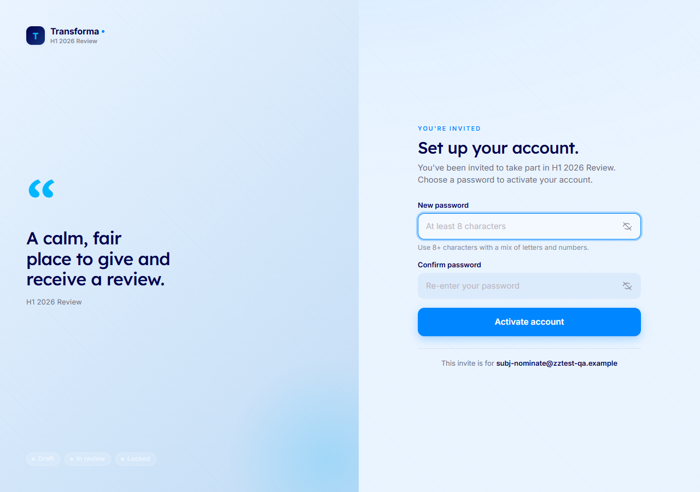
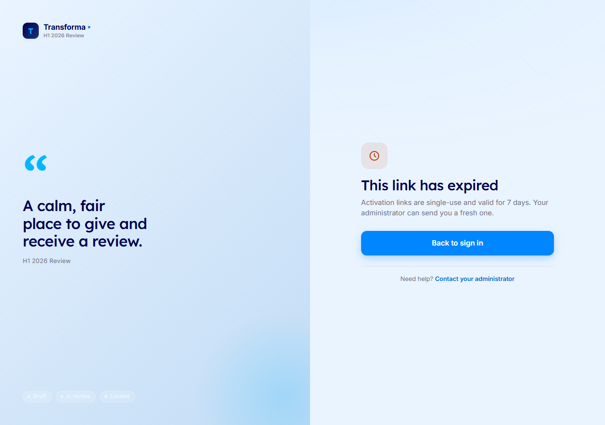
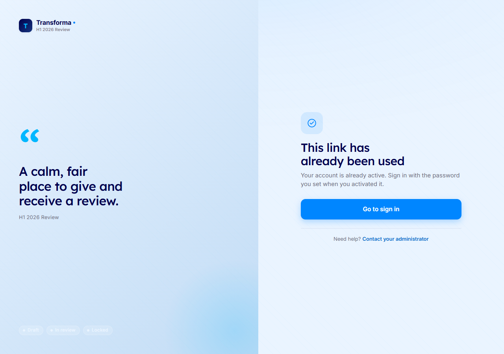
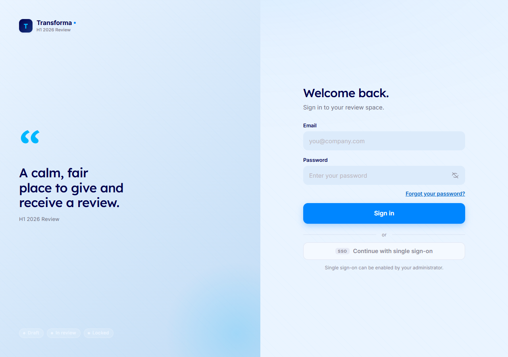
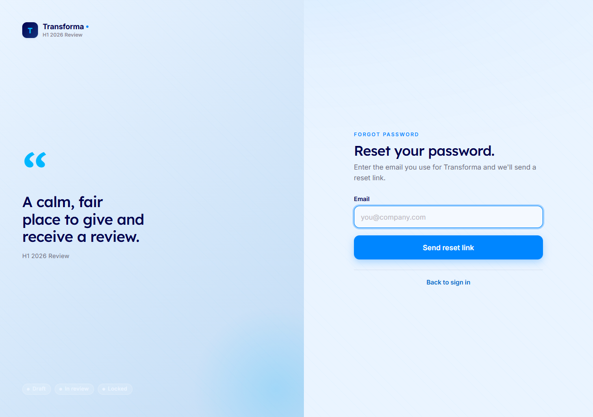
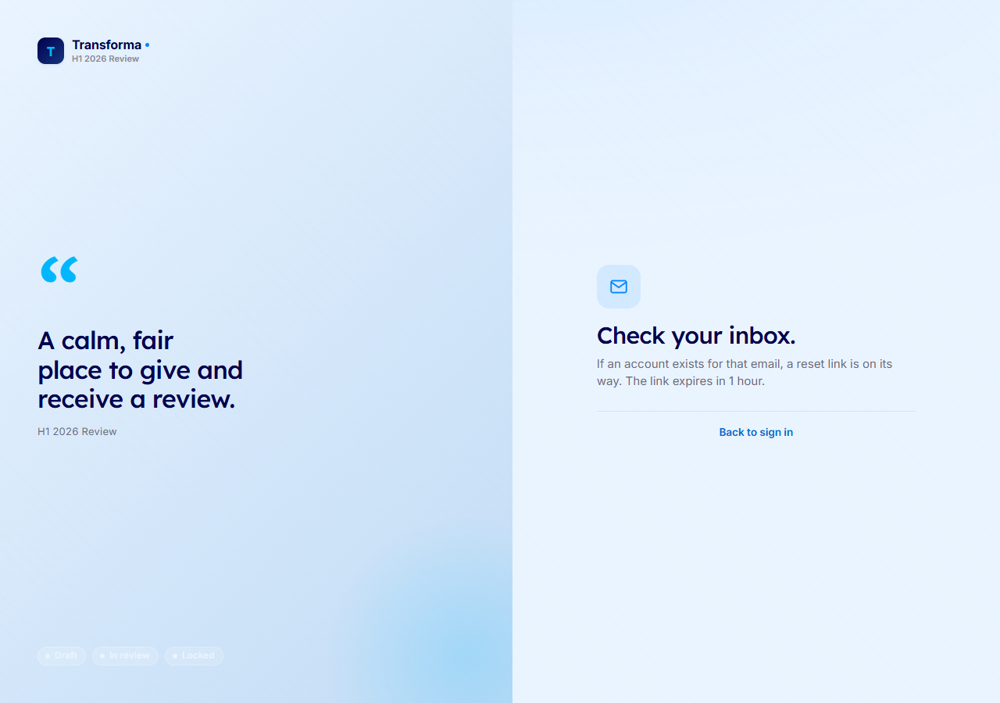
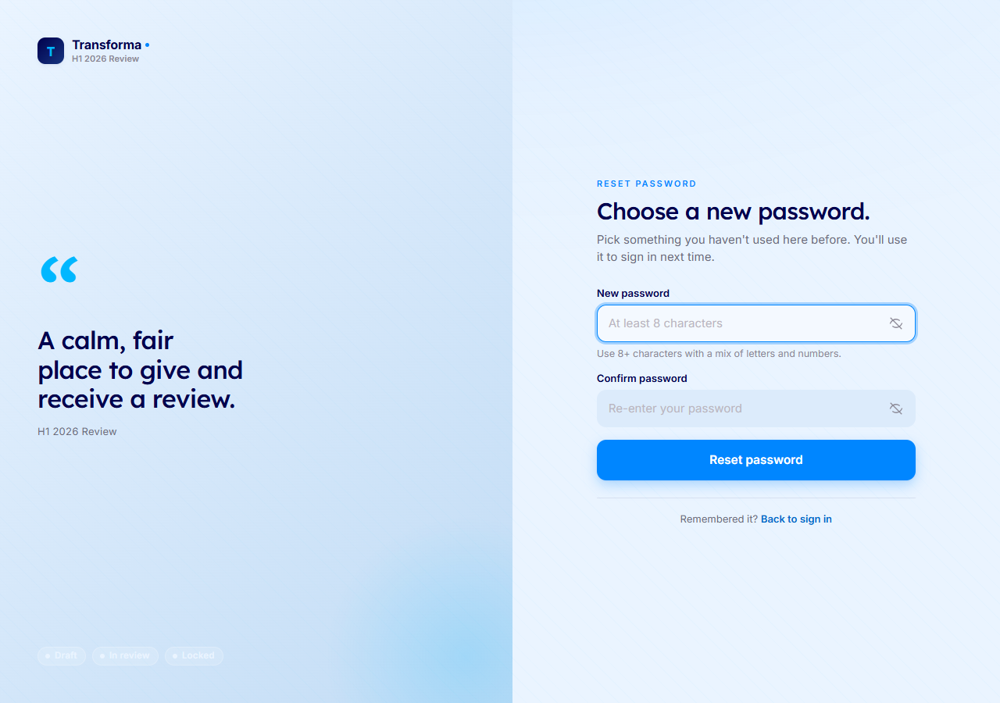
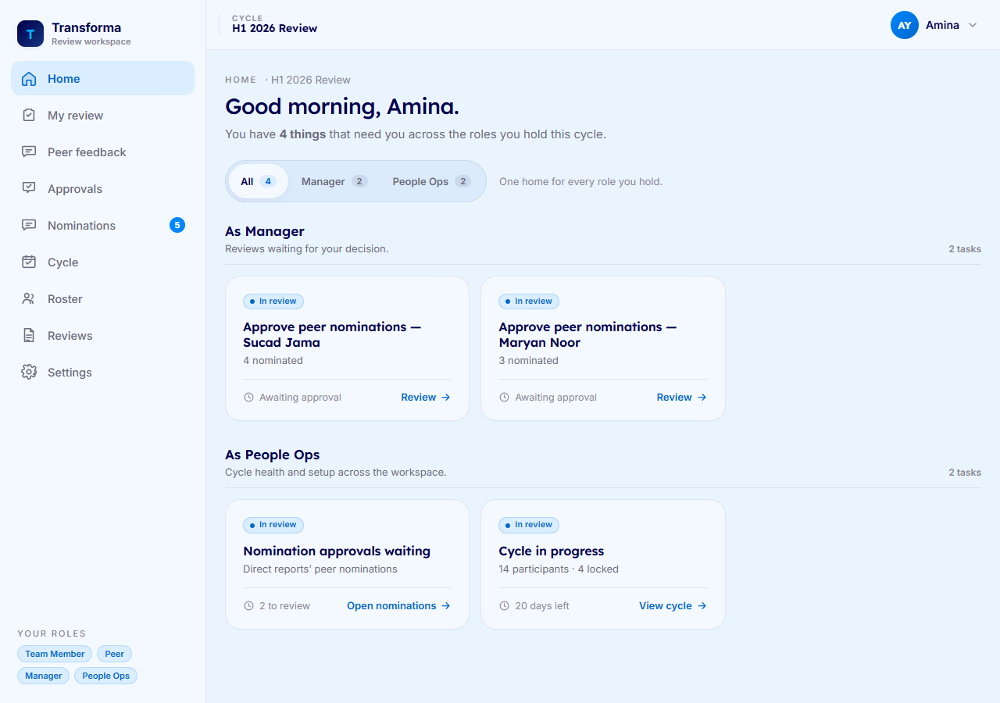
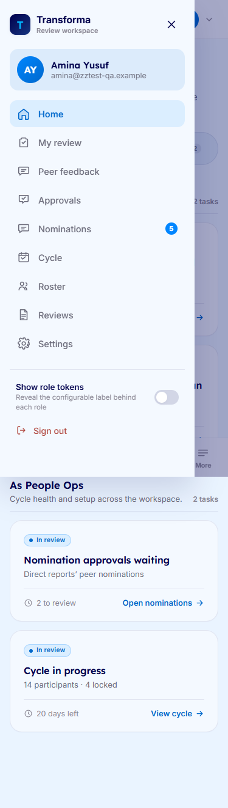
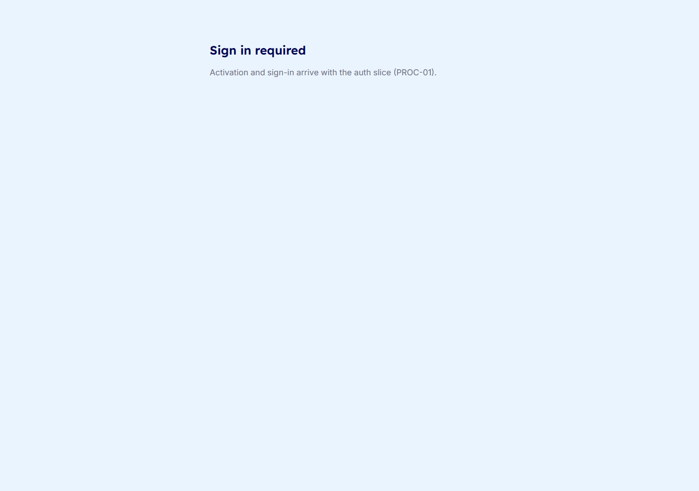

# Transforma — User Guide

Welcome to Transforma, your calm and fair place to give and receive a performance review at Riverbend Health. Your self-review and the confidential feedback from your colleagues are synthesized into a draft narrative that your Manager reviews, finalizes, and rates. You then read the finished review and acknowledge it, all in one place — whatever roles you hold.

## Guides by role

- [Team Member guide](team-member.md)
- [Peer guide](peer.md)
- [Manager guide](manager.md)
- [People Ops guide](people-ops.md)

---

## Activate your account

*What this is for:* Turning your emailed invite into a working account so you can sign in.

1. Open the invite email from Riverbend Health and click the activation link.
2. Choose a password. Watch the strength meter as you type, and use the show/hide control if you want to check what you entered.
3. Re-enter the same password in the confirm field so the two match.
4. Submit. You land signed in and ready to go — no second login needed.

If your link has expired, the screen tells you so and explains how to request a fresh invite from your People Ops admin.

If the link was already used, the screen says the account is active and points you to sign in instead of activating again.

---

## Sign in and recover your password

*What this is for:* Getting into Transforma day to day, and resetting your password if you forget it.

1. Go to the sign-in screen and enter your email and password.
2. Submit to enter Transforma.

If you have forgotten your password:

1. Click **Forgot your password?** on the sign-in screen.
2. Enter the email address for your Riverbend Health account.

3. Submit. Transforma confirms that a reset link is on its way — check your inbox.

4. Open the reset link from the email, choose a new password, confirm it, and submit. You are signed in with your new password.

---

## Your home — every role in one place

*What this is for:* Seeing everything that needs your attention, grouped by the part you play.

1. After signing in you land on your home screen.
2. Your tasks are grouped by the role they belong to — what you owe as a Team Member, as a Peer, as a Manager, and as People Ops — so each group only shows up if you hold that role.
3. Each group shows a **live count** of what's waiting, so you can see at a glance where to start.
4. Use the **role filter** to focus on a single role and hide the rest when you only want to work one part.
5. Select any task to jump straight to the exact screen for it — no hunting through menus.

---

## On your phone

*What this is for:* Doing everything you can do at a desk, from a phone-sized screen.

1. Open Transforma in your phone's browser. Every section you hold a role for is reachable.
2. Use the **bottom navigation** to move between the main areas with your thumb.
3. Tap the menu to open the **drawer** for the full list of sections and to sign out.

---

## Sign out

*What this is for:* Ending your session securely when you're done.

1. Open the menu (top of the screen on desktop, or the drawer on a phone).
2. Choose **Sign out**. Your session is cleared and you're returned to the sign-in screen.

---

*If something looks off — a link won't work, a task is missing, or a screen doesn't match what you expect — contact your People Ops admin at Riverbend Health.*
