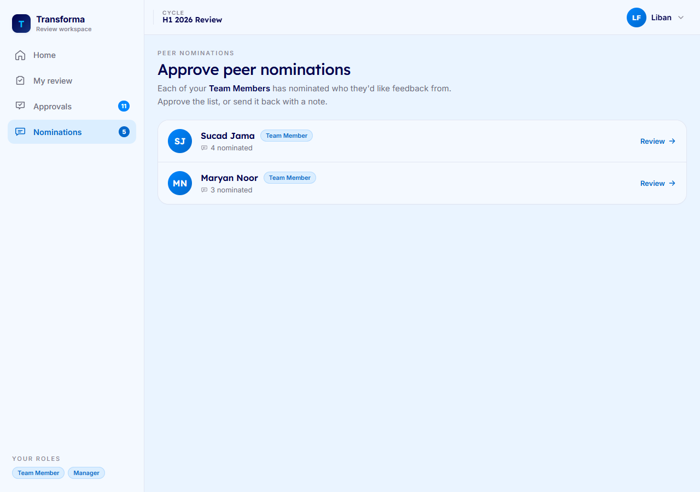
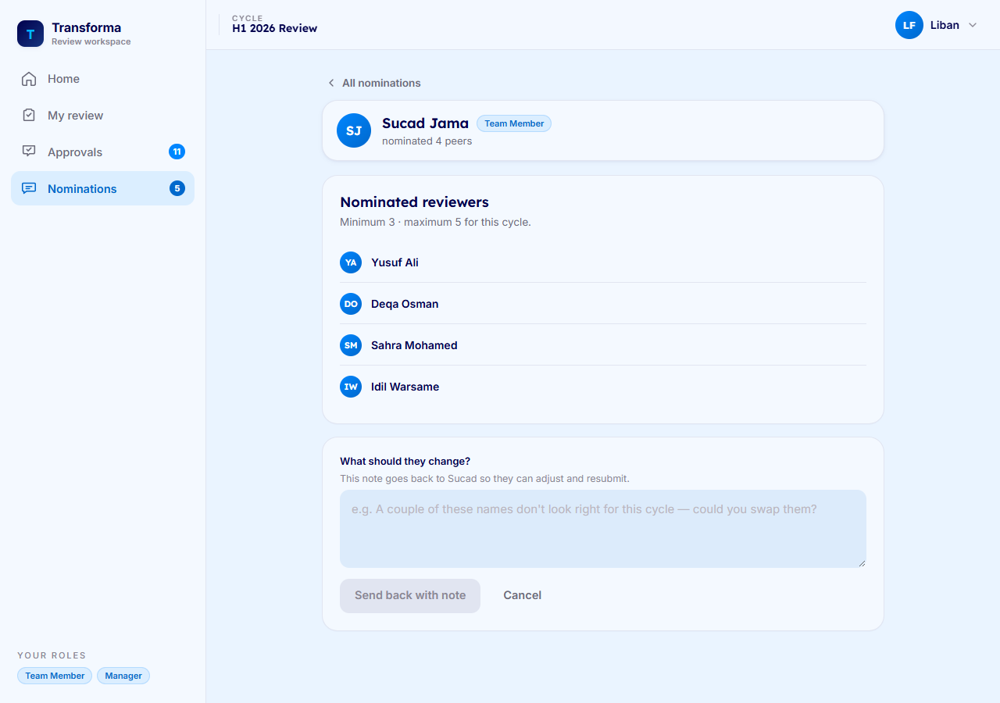
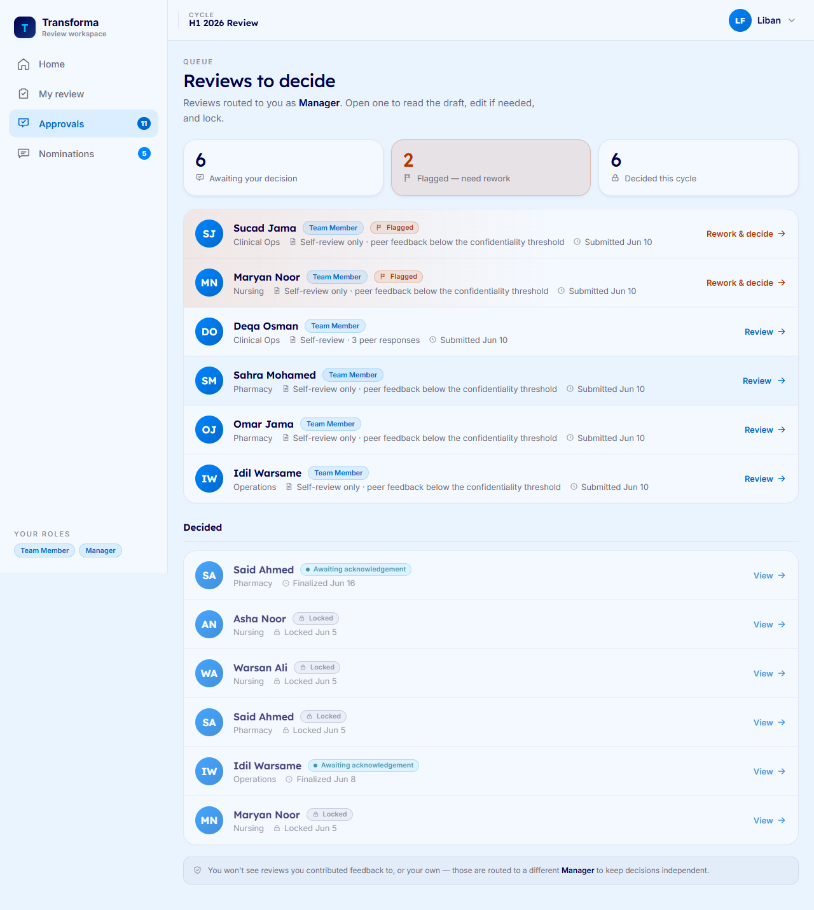
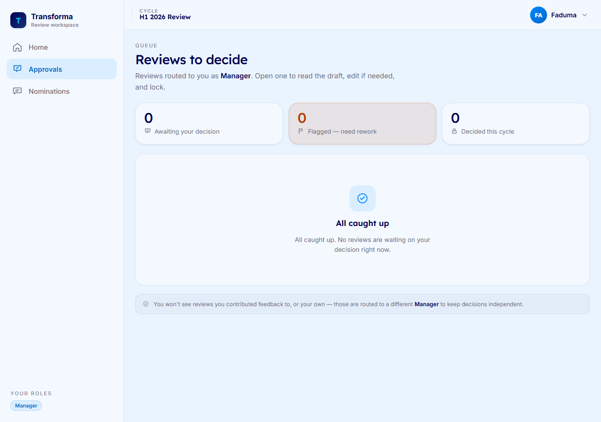
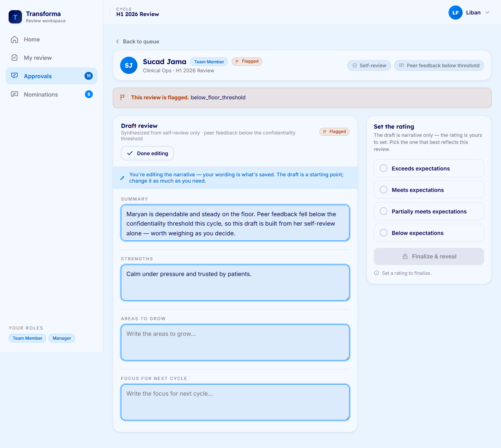
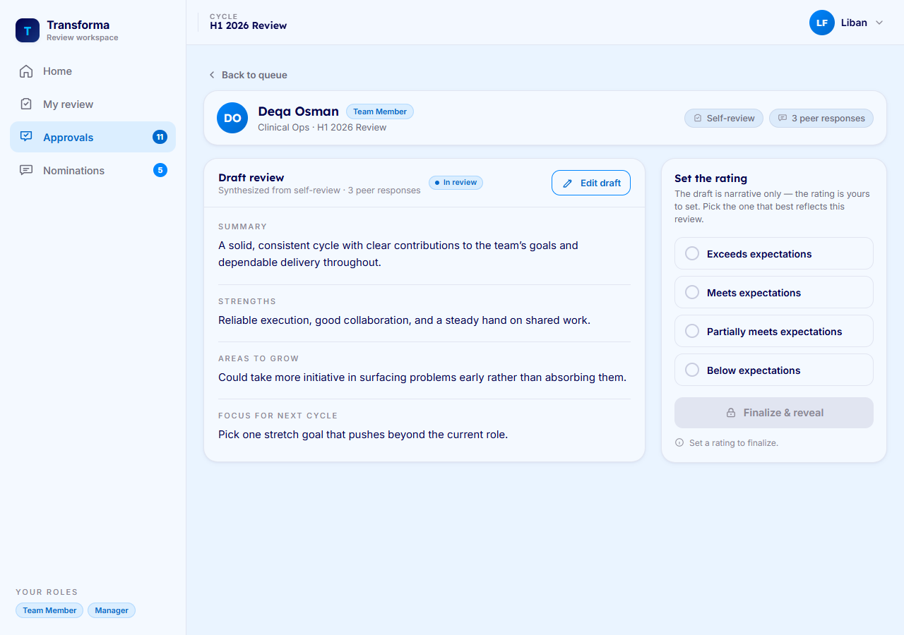
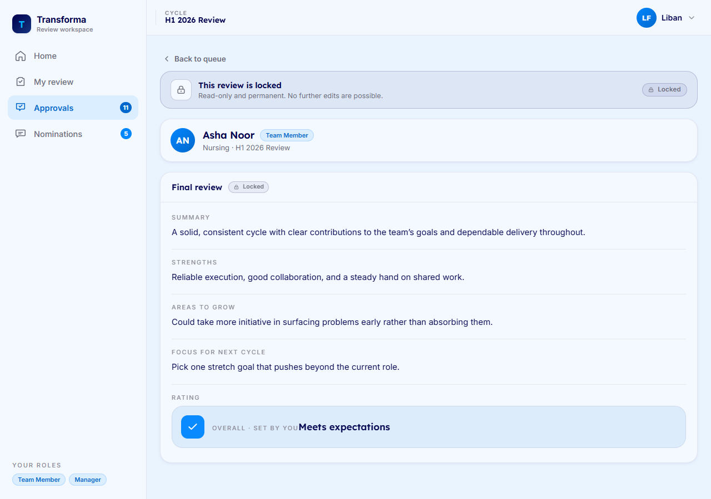

# Manager Guide

Welcome. As a **Manager** at Riverbend Health, you guide your Team Members' reviews from start to finish: you approve who they ask for feedback, you shape each draft review, you set the rating, and you finalize it so they can read it. This guide walks through the four things you'll do most often.

A quick note on how the draft works: Transforma synthesizes the real self- and peer feedback into a draft narrative for you to start from. It never sets the rating — **you write the rating yourself**.

---

## Approve or return peer nominations

*What this is for: deciding whether the people a Team Member picked for feedback are the right ones, before requests go out.*

1. Open **Peer nominations** to see everyone whose list is waiting on you.
2. Click a Team Member's row to open their list. You'll see each nominee with their **department**, plus the minimum and maximum number of peers allowed for this cycle.
3. If the list looks right, click **Approve nominations**. Feedback requests go out to those people.
4. If you'd like changes, click **Request changes**, write a short note explaining what to adjust, and click **Send back with note**. A note is **required** — your Team Member sees it word for word and can resubmit.
5. If the list has fewer than the recommended number of peers, you'll see a notice that it's below the confidentiality threshold. You can still approve it, but be aware: if too few peers end up responding, the review will draw on the self-review alone.

---

## Triage your queue

*What this is for: seeing at a glance which reviews are waiting on you and which you've already decided this cycle.*

1. Open your **Reviews to decide** queue.
2. The summary at the top shows how many reviews are **awaiting your decision**, how many are **flagged** and need rework, and how many you've **decided this cycle**.
3. Work the **pending** list first. Flagged items surface at the top and are clearly marked so you can give them a closer look before deciding.
4. The **Decided** section lists reviews you've already finalized, with the date they were finalized or locked. These are read-only.
5. When there's nothing waiting, you'll see an **All caught up** message — no action needed.

> You won't see reviews for yourself, or any review you contributed feedback to. Those are routed to a different Manager so every decision stays independent.

---

## Edit the draft and set the rating

*What this is for: shaping the draft narrative into the review you want to deliver, then setting the rating yourself.*

1. Open a review from your queue to land in the workspace. The draft narrative is organized into **Summary**, **Strengths**, **Areas to grow**, and **Focus for next cycle**.
2. Click **Edit draft** to change any section. The draft is only a starting point — your wording is what gets saved. Edited sections are marked **Edited** so you can see what you've changed. Click **Done editing** to save.
3. On the right, under **Set the rating**, pick the option that best reflects this review. The draft is narrative only; **the rating is yours to set**. Your choice saves as soon as you pick it.
4. Your edits are never lost — even if you finalize while a section is still open, your typed wording is preserved before the review locks.

When fewer than three peers responded, the draft is built from the **self-review alone**. The workspace tells you this plainly and the peer count is concealed — you'll never see a number below the threshold. Read these drafts especially carefully and edit as needed before setting a rating.

---

## Finalize and reveal

*What this is for: completing a review so your Team Member can read and acknowledge it.*

1. Once you've set a rating, click **Finalize & reveal**.
2. A confirmation appears summarizing the rating you set and explaining what happens next: the review is **revealed to your Team Member**, who is notified to read and acknowledge it.
3. The review **locks permanently** only after they acknowledge it, or when the acknowledgement window closes — never before. If you need to make a last change, click **Keep editing**.
4. Click **Finalize & reveal** in the confirmation to complete it. The review moves to *Awaiting acknowledgement*.

5. Afterwards, the review becomes **read-only** for you, with its status visible in your Decided section. There's no further editing once it's on its way to your Team Member.

---

*If something looks off — a review you didn't expect, a missing nomination, or a status that seems wrong — reach out to your People Ops admin.*
