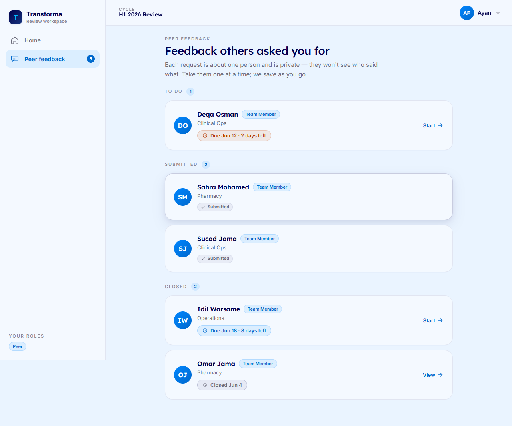
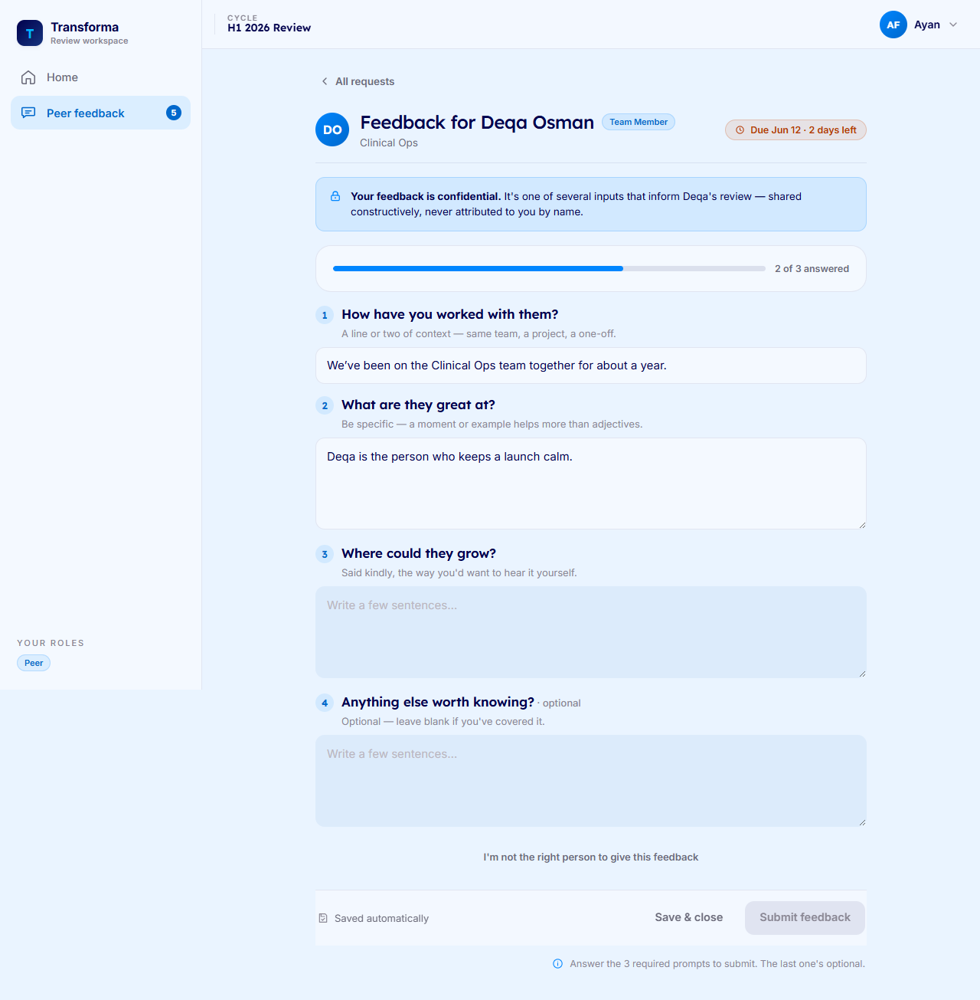
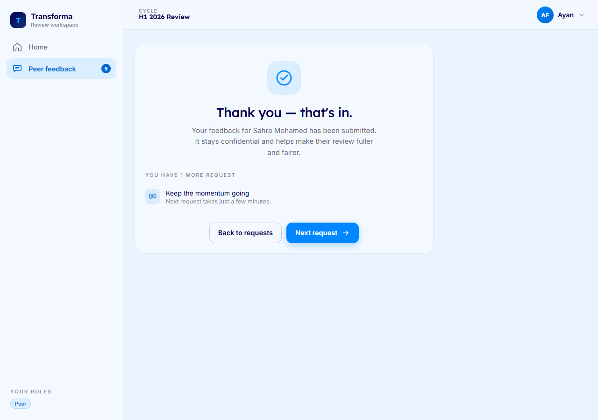
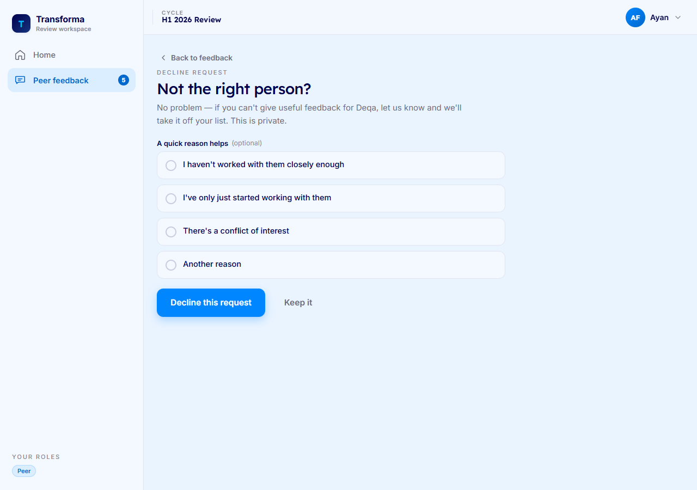

# Giving Peer Feedback — A Guide for Peers

When a colleague at Riverbend Health is going through their review, you may be asked to share feedback about working with them. This guide walks you through finding your requests, sharing feedback safely, and stepping aside when you're not the right person to respond.

Your feedback is always confidential. It is never shown with your name attached, and it is only ever used in a review when at least 3 peers respond. If fewer than 3 peers respond, the draft is built from the person's own self-review alone, and your words are set aside.

---

## See what feedback you owe

*What this is for: a single place to see who has asked for your feedback and when each request is due.*

1. Open Transforma and go to your **Peer** feedback list.
2. Each request shows the **person** you'd be giving feedback about, their **department**, and the **due date**.
3. Watch for the tinted requests — anything due within **3 days** is highlighted so you can prioritize it.
4. Requests that are already done or past their window appear in a separate **closed** section, so your active list stays clear.

---

## Give feedback safely

*What this is for: sharing honest, confidential feedback about a colleague without worrying about losing your work.*

1. From your list, open the request for the person you want to respond to.
2. Answer the questions in your own words. There's no need to be exhaustive — focus on what's genuinely helpful.
3. Your answers **save as you go**, so you can step away and come back without losing anything.
4. When you're ready, submit. You'll see a confirmation that your feedback is in.

Your words are confidential. They are never attributed to you, and they are only ever used in the review when at least 3 peers respond — the anonymity floor. Below that floor, your feedback is excluded entirely and the draft is built from the person's self-review alone.

---

## Decline when you're not the right person

*What this is for: stepping aside cleanly when you haven't worked closely enough with someone to give meaningful feedback.*

1. Open the request you'd like to decline.
2. Choose **Decline**, then pick a **reason** from the list.
3. Confirm. Your reason is recorded, and the request is taken off your list — there's nothing more for you to do.

---

*If something looks off — a request you don't recognize, a missing form, or a due date that doesn't seem right — reach out to your People Ops team and they'll help sort it out.*
