# People Ops Guide — Transforma at Riverbend Health

Welcome. As People Ops you set up and run the review cycle, keep the roster current, name
the roles in Riverbend's own language, and handle the occasional exception. You do **not**
read people's individual reviews in the course of running the cycle — and even the one place
that lets you read a finished record is deliberately limited and fully recorded (see the last
two sections).

---

## Create, configure, and start a cycle

*What this is for: opening a review cycle so everyone on the roster can begin their reviews.*

1. Open the **Cycle** area. If no cycle exists yet, you'll see a calm empty state with a
   clear button to create your first one.
2. Click to create the cycle. The setup form opens.
3. Fill in the cycle **name**, the **opens** and **closes** dates, the allowed **peer
   nomination range**, and the **acknowledgement window** length.
4. Click **Save** to keep your changes. If you change your mind, **Cancel** reverts every
   field back to the last saved values — nothing is silently discarded.
5. When you're ready, click **Start**. This opens reviews for everyone on the roster. Start
   is safe to run again — re-running it won't duplicate or disturb anyone's existing review.

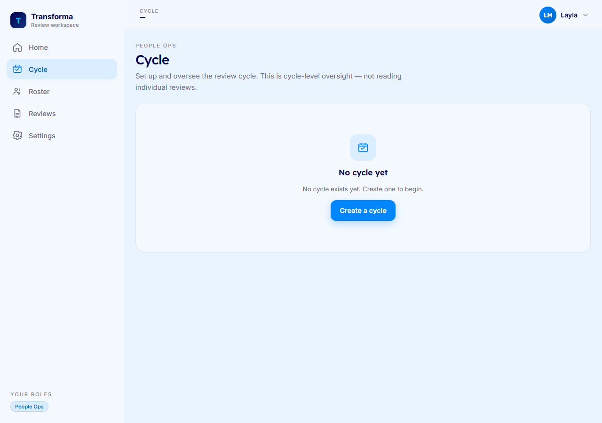

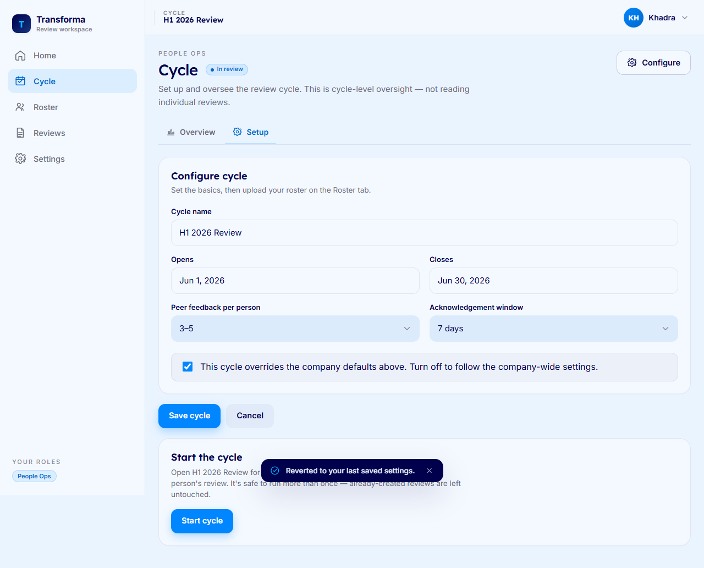

---

## Steer a running cycle

*What this is for: seeing how the whole cycle is progressing at a glance.*

1. Open the **Cycle** monitor for the active cycle.
2. Read the headline figures: **days left** in the cycle and the **participant count**.
3. Check the **milestone meters** to see how many self-reviews, peer-feedback responses, and
   manager decisions are done out of the total.
4. Scan the **status distribution** to see where everyone sits across the cycle.

These are cycle-level counts only — the monitor never shows any individual's review content.

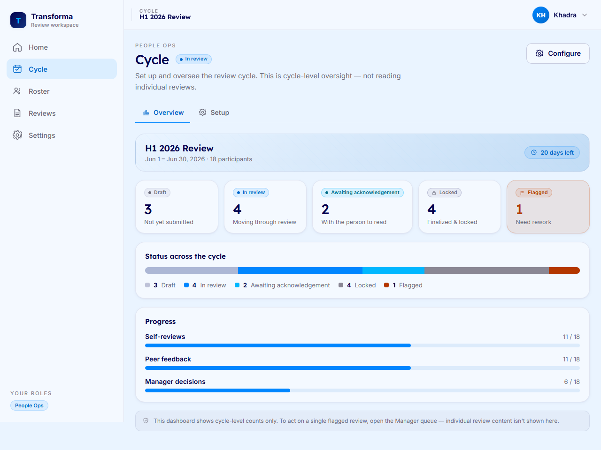

---

## Import the roster

*What this is for: adding the people who will take part in the cycle.*

1. Open the **Roster** area. Download the **CSV template** so your file has the right columns.
2. Fill in the template, then **drop the file** onto the upload area or **browse** to select it.
3. The system runs a **read-only preview**: every row is validated and shown to you, but
   **nothing is imported yet**.
4. Review the preview. If a file has any bad rows it is rejected **all-or-nothing**, and you
   can download an **error report** that explains exactly what to fix.
5. When the preview looks right, click **Confirm & add to cycle** to actually import the
   people. Until you click this, no one has been added.

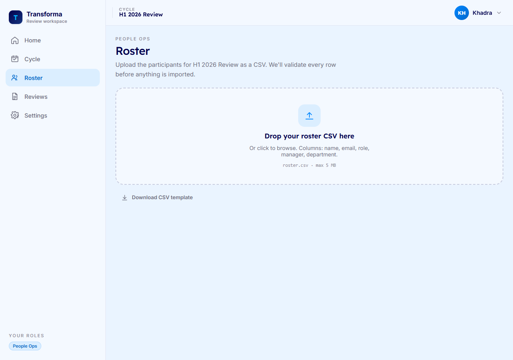

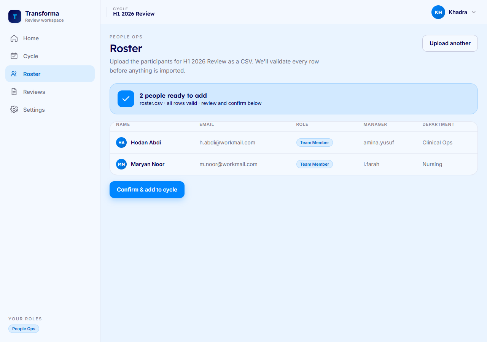

---

## Name the roles in your language

*What this is for: making the app speak Riverbend's vocabulary for each role.*

1. Open **Settings** and find the role labels section.
2. Edit the label for each role to match what people at Riverbend actually call it (for
   example, "Manager" or "People Ops").
3. Click **Save**. Your wording now applies **everywhere** in the app — every screen updates
   to use your labels.

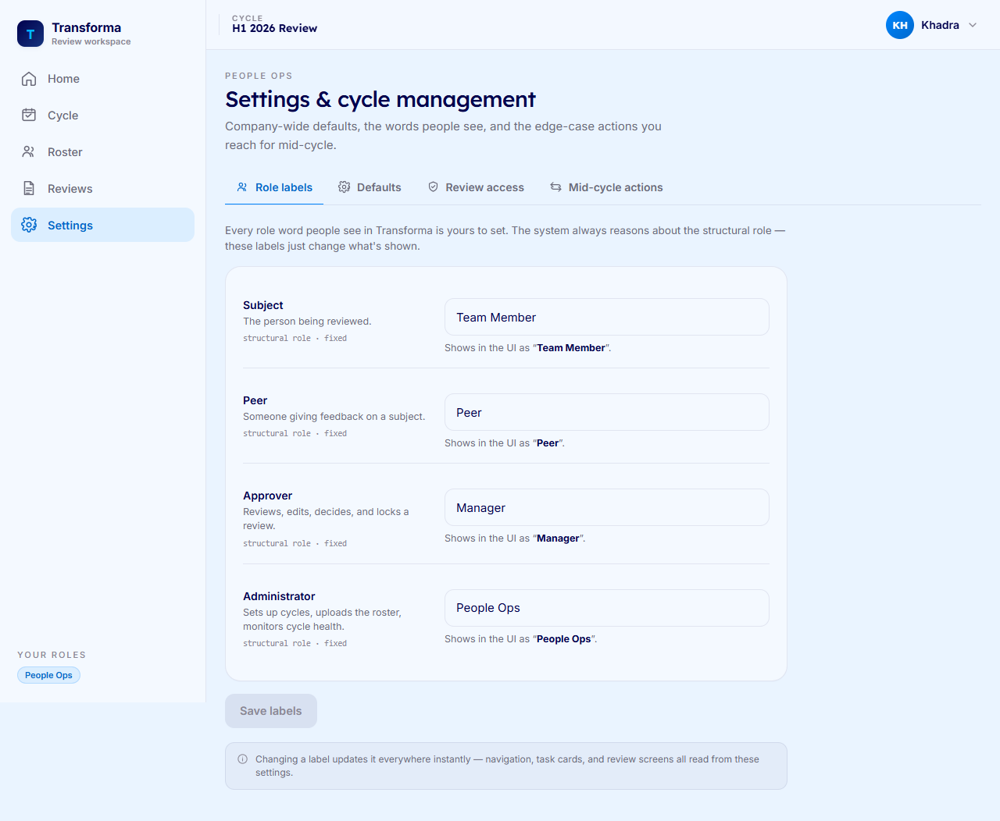

---

## Handle mid-cycle exceptions

*What this is for: dealing with the real-life changes that come up while a cycle is running.*

1. Open the **Settings** exceptions area for the person concerned.
2. To move a review to a different **Manager**, use **reassign**. The system re-checks
   separation of duties and refuses any assignment that would let someone manage their own
   review or a review they contributed to.
3. To give one person more time, use **extend** — this covers both the feedback window and
   the acknowledgement window.
4. If someone has left, use **withdraw** to take them out of the cycle; their feedback is
   archived and never surfaced.
5. Every one of these actions is recorded in the audit log.

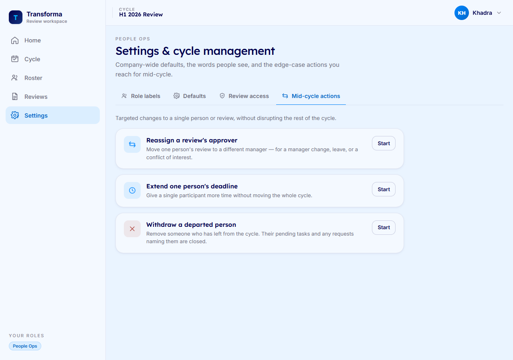

---

## Govern who can read reviews

*What this is for: controlling who, if anyone, may open a finished review record.*

1. Open the **Settings** access-governance section.
2. Use the **company switch** to turn review reading on or off for the whole workspace.
3. Grant or revoke the read capability **per admin**. Note the helper text: holding the
   People Ops role **alone grants nothing** — a person must be explicitly granted the
   capability before they can open any record.
4. Every grant and revoke is recorded in the audit log.

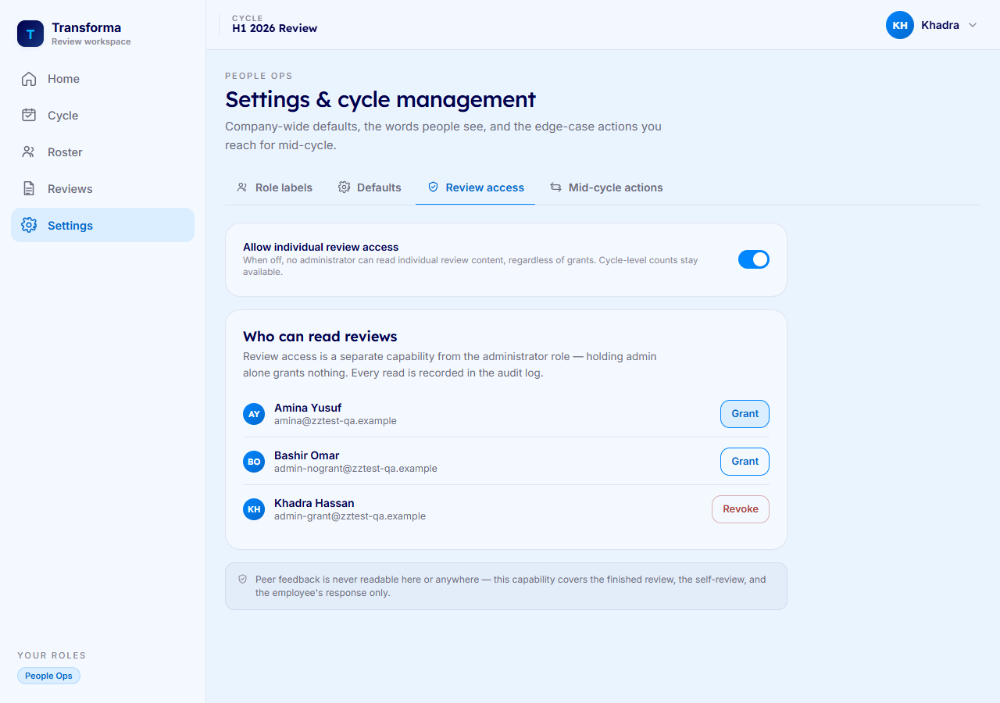

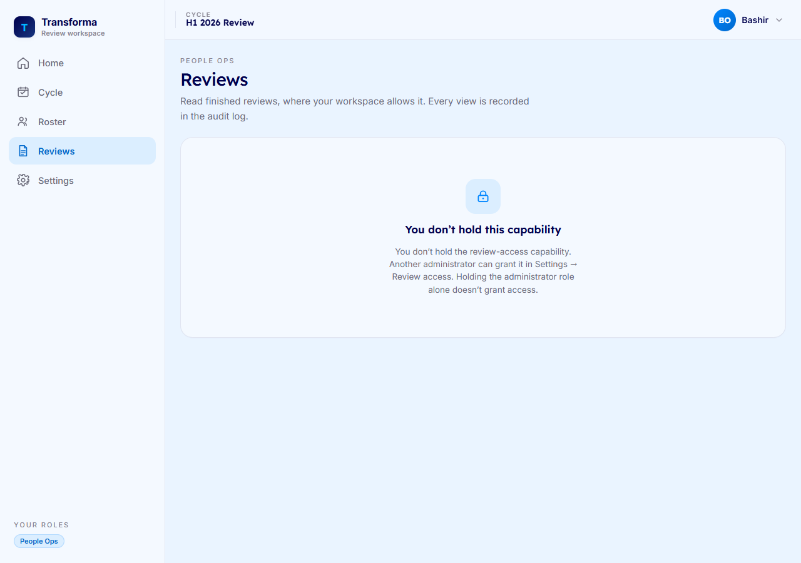

---

## Read a sealed record, accountably

*What this is for: looking at a single finished review when you have a legitimate need and the
capability to do so.*

1. Open the **Reviews** reader. It lists **finished reviews only** — nothing in progress.
2. Note the on-screen notice: **every time you open a record, it is recorded in the audit
   log.** Open records only when you genuinely need to.
3. Click a review to open it. You'll see the **narrative**, the **rating**, the person's
   **self-review**, and any **written response** they attached.
4. **Peer feedback is never shown here.** It is structurally absent from this view, so peer
   confidentiality is preserved no matter who reads the record.

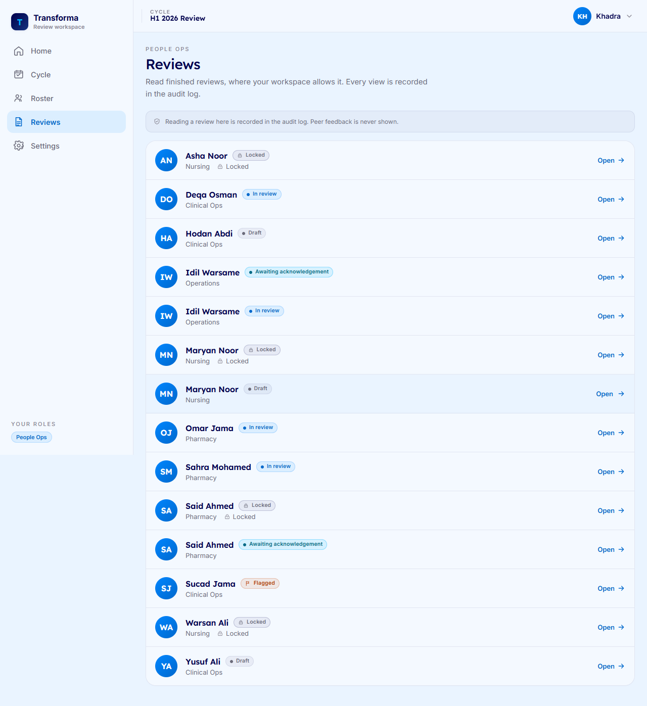

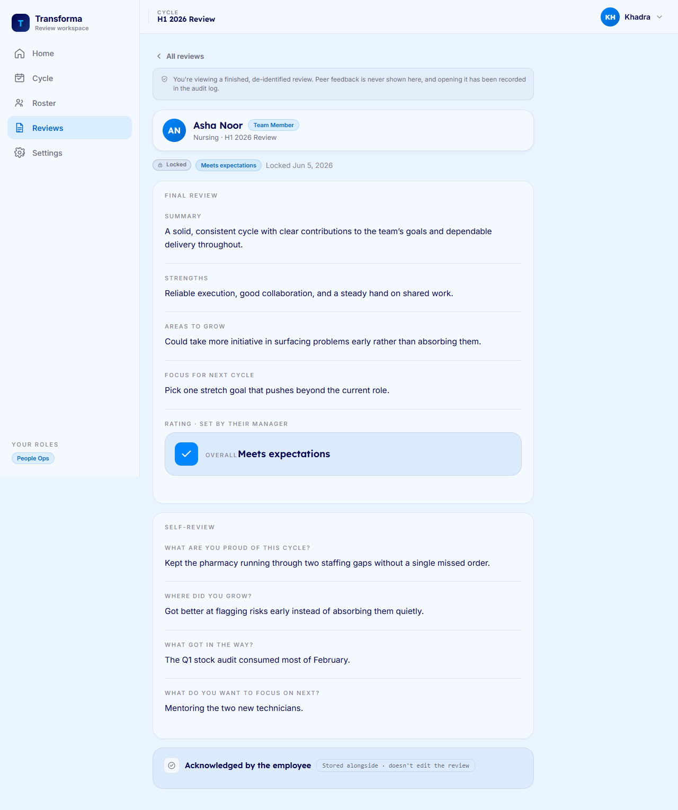

---

*If something looks off, contact your People Ops admin.*
